# Отчёт по лабораторной работе №3: поиск новизны в задаче навигации в лабиринте

Выполнил: Егоркин Станислав, гр. 5140901/61501

## 1. Постановка задачи

Работа исследует подход Novelty Search (поиск новизны, Дж. Леман и К. Стэнли, 2008–2011) на задаче их основного эксперимента - навигации робота в «обманчивом» лабиринте.

Робот с нейросетевым контроллером должен за 400 шагов добраться от старта до выхода. Контроллер не программируется вручную, а выращивается нейроэволюцией NEAT. Задача обманчива: ближайшая к выходу по прямой точка - тупик, и чтобы выйти, надо сначала удалиться от цели. Поэтому отбор по близости к цели ведёт популяцию в ловушку.

Особенность подхода: отбор идёт не по целевой функции, а по новизне поведения - насколько поведение особи не похоже на поведение уже встреченных. Это формализация идеи «творческого» поиска без заданной цели.

Задачи работы:

1. Реализовать программную модель: симулятор робота и лабиринта, меру новизны с архивом, связку с NEAT.
2. Проверить работоспособность на тестовых данных авторов - картах «средний» и «сложный» лабиринт.
3. Построить характеристические карты: влияние параметров модели и сложности лабиринта на качество работы.
4. Сравнить подход с аналогами: целевым NEAT, случайным отбором, MAP-Elites и модификацией MCNS.

## 2. Теоретическая база

### 2.1. Эволюционный алгоритм и NEAT

Эволюционный алгоритм (Дж. Холланд, 1975) работает циклом: популяция решений → оценка → отбор → скрещивание и мутации → новое поколение. Качество особи задаётся целевой функцией (приспособленностью).

NEAT (NeuroEvolution of Augmenting Topologies, К. Стэнли и Р. Мииккулайнен, 2002) применяет этот цикл к нейронным сетям. Его три ключевые идеи:

- эволюционируют и веса, и структура сети: мутации добавляют нейроны и связи;
- сети начинают с минимальной структуры и постепенно усложняются;
- схожие сети объединяются в виды (специация), а гены сопоставляются по историческим меткам (номерам инноваций), чтобы новые структуры успели настроиться, прежде чем конкурировать со всей популяцией.

### 2.2. Проблема обманчивой целевой функции

Задача называется обманчивой, если целевая функция ведёт поиск в локальный оптимум, из которого нет постепенного пути к решению. В лабиринте целевая функция «близость к выходу» награждает роботов, упершихся в стену у выхода, и наказывает тех, кто идёт в обход. Популяция сходится к тупику - это преждевременная сходимость.

### 2.3. Поиск новизны

Поиск новизны заменяет целевую функцию мерой новизны поведения. Поведение особи описывается вектором b(x) - в задаче лабиринта это координаты точки, где робот остановился. Новизна - среднее расстояние до k ближайших соседей среди текущей популяции и архива:

```latex
\rho(x) = \frac{1}{k}\sum_{i=1}^{k} \operatorname{dist}\big(b(x),\, b(\mu_i)\big)
```

где μᵢ - i-й ближайший сосед, dist - евклидово расстояние.

Архив хранит поведения, которые уже были найдены: особь попадает в него, если ρ(x) > ρmin. Благодаря архиву поиск не возвращается в уже исследованные области. Порог подстраивается динамически: растёт, если в архив попадает слишком много особей, и падает, если долго никто не попадает.

Цель при этом не направляет поиск, но проверяется: запуск считается успешным, как только любой робот достиг выхода. Идея опирается на наблюдение: в сложных задачах промежуточные шаги к решению часто не похожи на само решение, и систематическое исследование новых поведений находит их надёжнее погони за целью.

### 2.4. Результаты авторов подхода

В статье Lehman, Stanley (2011) на каждый метод делали 40 запусков с лимитом 250 000 оценок.

| Метод | Средний лабиринт | Сложный лабиринт |
| --- | --- | --- |
| Поиск новизны | 40 из 40, в среднем 18 274 оценки | 39 из 40, в среднем 35 109 оценок |
| Целевой NEAT | 40 из 40, в среднем 56 334 оценки | 3 из 40 |
| Случайный отбор | 21 из 40 | 4 из 40 |

## 3. Описание разработанного ПО

ПО написано на Python 3 с библиотеками neat-python (реализация NEAT), NumPy и Matplotlib. За основу модели робота и карты лабиринтов взяты примеры из книги Я. Омельяненко «Hands-On Neuroevolution with Python» (2019, лицензия MIT), повторяющие эксперимент Лемана и Стэнли. Параметры модели задаются из командной строки, статистика каждого запуска сохраняется автоматически.

### 3.1. Структура программы

| Модуль | Назначение | Основные функции |
| --- | --- | --- |
| `nsmaze/maze.py` | Лабиринты: загрузка, сохранение, генерация, оценка сложности | `Maze.load`, `Maze.save`, `Maze.difficulty`, `generate_grid_maze`, `open_maze` |
| `nsmaze/simulator.py` | Модель робота: датчики (входы сети), движение, столкновения; описание поведения | `_sensors`, `simulate`, `behaviors` |
| `nsmaze/batchnet.py` | Векторное вычисление всех сетей популяции за один шаг (ускорение в 2–3 раза) | `BatchNetwork.activate` |
| `nsmaze/novelty.py` | Мера новизны и архив с динамическим порогом | `NoveltyArchive.novelty`, `NoveltyArchive.update` |
| `nsmaze/evolution.py` | Запуск эволюции для всех методов, сбор статистики, параллельные серии | `Params`, `run`, `run_many`, `RunResult`, `Coverage` |
| `nsmaze/plots.py` | Рисунки: тепловые карты, траектории, сравнение методов, характеристические карты | `heatmap`, `figure_run`, `figure_heatmaps_compare`, `figure_sweep_1d` |
| `run_experiment.py` | Серия запусков: методы × лабиринты | - |
| `sweep.py` | Перебор значений одного или двух параметров | - |
| `make_mazes.py`, `make_figures.py` | Генерация набора лабиринтов; перерисовка рисунков по сохранённым результатам | - |  

### 3.2. Модель робота и входные данные сети

- Радиус робота 8 ед.; при столкновении со стеной робот не сдвигается.
- 10 входов сети: 6 дальномеров (−90°, −45°, 0°, 45°, 90°, 180° к курсу, дальность 100, нормированы к 0…1) и 4 радара-сектора по 90° (1, если выход в этом секторе).
- 2 выхода сети: приращения угловой и линейной скорости (выход − 0,5), обе ограничены ±3.
- Одна оценка - 400 шагов; выход найден, если робот подошёл к нему ближе чем на 5 ед.
- Поведение для меры новизны: точка остановки (x, y) или траектория - позиции через каждые 50 шагов.

### 3.3. Тестовые данные

Карты `medium` и `hard` - авторские лабиринты из статьи Lehman, Stanley (2011) в формате репозитория к книге Омельяненко. Для исследования влияния сложности добавлен генератор лабиринтов на сетке N×N (поиск в глубину): выход ставится так, чтобы путь до него был много длиннее расстояния по прямой. Сложность лабиринта оценивается длиной кратчайшего пути и «обманчивостью» - отношением длины пути к расстоянию по прямой.

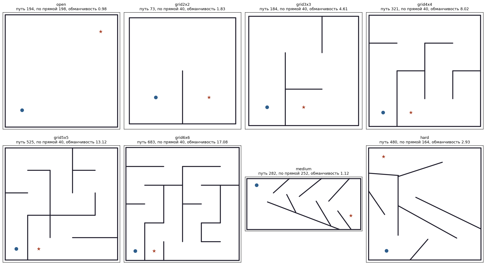
[Рисунок 1 - «Набор лабиринтов: синий круг - старт, звезда - выход»\]

### 3.4. Методы и параметры

Параметр `--method` выбирает способ отбора:

| Метод | Оценка особи |
| --- | --- |
| `novelty` - поиск новизны | ρ(x) по k ближайшим соседям |
| `fitness` - целевой NEAT | f = D − d, D - диагональ лабиринта, d - расстояние от точки остановки до выхода |
| `random` - случайный отбор | случайное число (контроль) |
| `mcns` - новизна с минимальным критерием | ρ(x), но 0 и без попадания в архив для особей, не продвинувшихся к выходу хотя бы на 1 % начального расстояния |
| `mapelites` - MAP-Elites | сетка 20×20 по точке остановки; в клетке хранится лучшая по f особь; потомки - мутации случайных элит |

Основные параметры (класс `Params`, задаются из командной строки):

| Параметр | По умолчанию | Смысл |
| --- | --- | --- |
| `pop_size` | 250 | размер популяции |
| `max_evals` | 100 000 | лимит оценок на запуск |
| `k` | 15 | число соседей в мере новизны |
| `threshold` | 6,0 | начальный порог архива ρmin |
| `dynamic_threshold` | да | +20 %, если за поколение добавлено больше 4 особей; −5 % после 10 поколений без добавлений |
| `behavior` | endpoint | описание поведения: точка остановки или траектория |
| `node_add_prob`, `conn_add_prob` | 0,1; 0,5 | вероятности добавления нейрона и связи |
| `weight_mutate_rate`, `weight_mutate_power` | 0,8; 0,5 | мутация весов |
| `steps` | 400 | шагов симуляции на оценку |

Остальные параметры NEAT заданы в `config/neat_maze.ini`: активация sigmoid, сеть прямого распространения с одним скрытым нейроном на старте и частичными связями (50 %), порог совместимости видов 3,0, стагнация вида - 20 поколений.

### 3.5. Накопление статистики и показатели качества

Каждый запуск сохраняется в файл `.pkl` (объект `RunResult`), сводка по серии - в `summary.csv` или `sweep.csv`. Показатели:

- **доля решённых запусков** - надёжность метода;
- **число оценок до решения** - скорость;
- **покрытие лабиринта** - доля проходимых клеток 10×10, в которых останавливался хотя бы один робот (широта исследования);
- **лучшее расстояние до выхода** - для нерешённых запусков;
- **размер архива и сети решения** (число узлов и связей).

Кроме того, для каждого поколения сохраняются история (лучшее расстояние, покрытие, размер архива, порог, средний размер сетей) и точки остановки всех роботов - из них строятся тепловые карты.

### 3.6. Взаимодействие функций

1. `run_experiment.py` или `sweep.py` собирает `Params` из аргументов и вызывает `run_many` - по одному процессу на запуск.
2. `run` создаёт популяцию NEAT и в каждом поколении строит сети, объединяя их в `BatchNetwork`.
3. `simulate` прогоняет всех роботов через лабиринт: на каждом шаге `_sensors` формирует входы, сеть выдаёт управление, робот движется.
4. `behaviors` превращает результат в описания поведения; `NoveltyArchive.novelty` считает новизну, `update` пополняет архив.
5. Новизна (или f для аналогов) записывается в геномы; NEAT выполняет отбор, скрещивание и мутации.
6. Запуск завершается, когда робот нашёл выход или исчерпан лимит оценок; статистика сохраняется, `plots` строит рисунки.

## 4. Проверка работоспособности и сравнение методов

На сложном лабиринте поиск новизны решил задачу во всех 8 запусках (медиана 9 348 оценок), а целевой NEAT и случайный отбор - ни в одном. Это воспроизводит качественный результат авторов (39 из 40 против 3 из 40).

### 4.1. План эксперимента

- Лабиринт: авторский `hard` (кратчайший путь 480, по прямой 164, обманчивость 2,93).
- Методы: поиск новизны, целевой NEAT, случайный отбор, MAP-Elites, MCNS.
- По 8 независимых запусков на метод (зёрна 0–7), лимит 100 000 оценок, параметры по умолчанию (раздел 3.4).
- Команда: `python run_experiment.py --maze hard --method novelty fitness random mapelites mcns --runs 8 --out results/hard`.

### 4.2. Результаты

Таблица 4.1 - Сравнение методов на лабиринте hard (8 запусков)

| Метод | Решено | Оценок до решения: медиана (мин–макс) | Покрытие, среднее | Лучшее расстояние в нерешённых | Сеть решения: узлов / связей |
| --- | --- | --- | --- | --- | --- |
| Поиск новизны | 8 из 8 | 9 348 (2 737–27 451) | 0,77 | - | 3,4 / 9,8 |
| MAP-Elites | 8 из 8 | 22 744 (4 151–89 661) | 0,80 | - | 3,3 / 12,2 |
| MCNS | 6 из 8 | 20 581 (8 186–69 238) | 0,77 | 38,9 | 3,2 / 7,7 |
| Целевой NEAT | 0 из 8 | - | 0,47 | 38,9 | - |
| Случайный отбор | 0 из 8 | - | 0,51 | 38,9–39,0 | - |

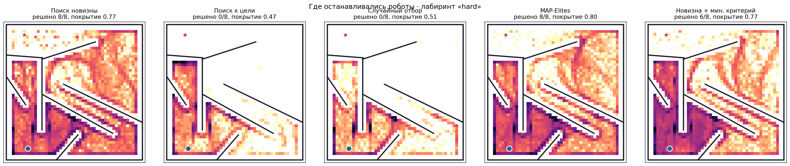
*Рисунок 2 - «Тепловые карты точек остановки роботов по всем запускам каждого метода (логарифмическая шкала)»*

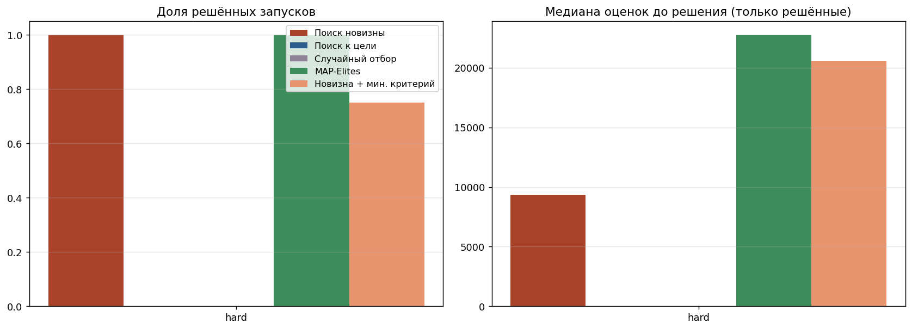
*Рисунок 3 - «Доля решённых запусков и медиана числа оценок по методам»*

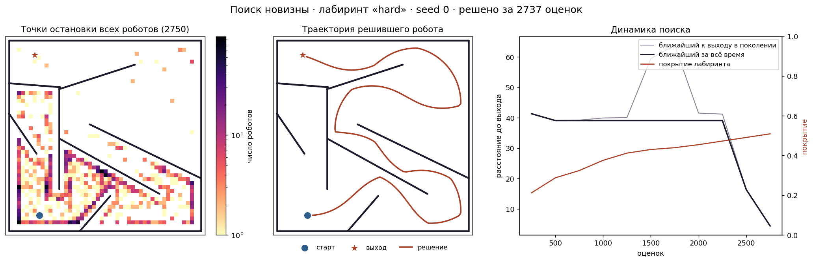
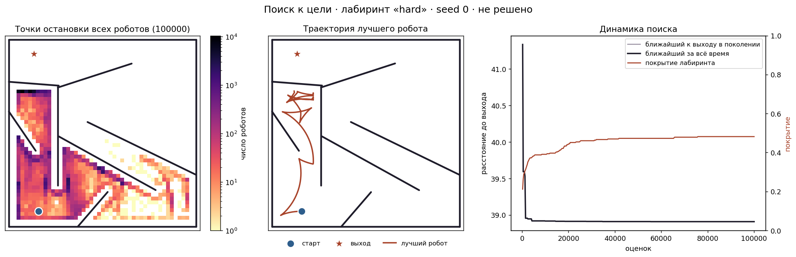
*Рисунок 4 - «Отдельные запуски: тепловая карта, траектория лучшего робота и динамика поиска»*

### 4.3. Анализ

**Ловушка 38,9.** Все нерешённые запуски остановились на одном и том же расстоянии 38,9 от выхода. Это тупик левого коридора прямо под выходом: ближе к выходу с этой стороны стены центр робота радиуса 8 не подойдёт. Целевой NEAT достигает ловушки за 2–5 тыс. оценок и остаётся в ней до конца: покрытие выходит на плато около 0,47. Это преждевременная сходимость в чистом виде.

**Случайный отбор** не сходится к ловушке (покрытие чуть выше - 0,51), но и не накапливает удачные поведения: отдельные роботы доходят до верхнего коридора, но теряются в следующем поколении.

**Поиск новизны** покрывает лабиринт в 1,6 раза лучше целевого NEAT (0,77 против 0,47) и проходит «невыгодный» обходной путь. Сети-решения очень просты: 3–4 узла (два из них - выходные) и около 10 связей. Значит, сложность задачи - не в том, чтобы построить сложный контроллер, а в том, чтобы его найти.

**MAP-Elites** тоже решил 8 из 8 и показал лучшее покрытие (0,80), но в среднем потребовал в 2,4 раза больше оценок: выбор родителей случаен и не отдаёт предпочтения клеткам на границе исследованной области.

**MCNS** решил 6 из 8, а два запуска застряли в той же ловушке 38,9. Причина - выбранный критерий «продвинуться к выходу хотя бы на 1 %»: он отсекает роботов, которые уходят в обход и пока дальше от цели, то есть частично возвращает обманчивость целевой функции. Для этой задачи более удачен критерий «отойти от старта» (`--mc-kind moved`).

**Время счёта.** Решённый запуск поиска новизны занимал в среднем 24 с, запуск целевого NEAT до лимита - около 5,4 мин (8 параллельных процессов).

Ограничения эксперимента: 8 запусков на метод (у авторов 40) и лимит 100 000 оценок (у авторов 250 000). При большем бюджете целевой NEAT мог бы изредка находить выход, как у авторов. Быстрее, чем у авторов (35 109 оценок), поиск новизны работает скорее из-за отличий реализации: нормированные входы, сеть прямого распространения, neat-python вместо авторской реализации.

## 5. Исследование системных свойств модели (характеристические карты)

Модель устойчива к размеру популяции, но чувствительна к числу соседей k (при k = 1 решено только 2 из 8) и к порогу архива; самый сильный фактор - сложность лабиринта: начиная с сетки 5×5 задача не решается за 100 000 оценок.

Во всех переборах: лабиринт `hard`, поиск новизны, 8 запусков на значение, лимит 100 000 оценок, остальные параметры по умолчанию. При 8 запусках различия медиан меньше чем в 1,5–2 раза нужно считать тенденцией, а не доказанным эффектом: разброс числа оценок между запусками достигает 10–30 раз.

### 5.1. Число соседей k

Таблица 5.1 - Влияние k (динамический порог, начальный 6)

| k | Решено | Оценок: медиана | Покрытие | Размер архива | Итоговый порог |
| --- | --- | --- | --- | --- | --- |
| 1 | 2 из 8 | 48 804 | 0,80 | 182 | 8,1 |
| 3 | 7 из 8 | 23 863 | 0,84 | 158 | 14,1 |
| 7 | 8 из 8 | 11 906 | 0,82 | 214 | 19,7 |
| 15 | 8 из 8 | 9 348 | 0,77 | 335 | 30,3 |
| 30 | 8 из 8 | 10 964 | 0,76 | 555 | 34,5 |

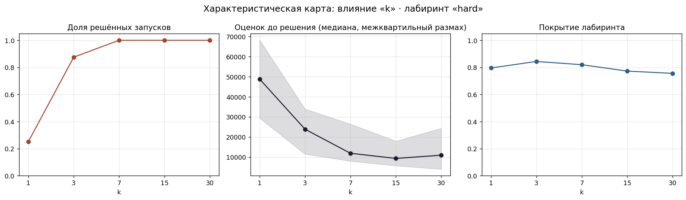

При k = 1 новизна считается по одному соседу и становится шумной: два близких робота считают друг друга «старыми», а пара роботов вдали от остальных - недостаточно новой. Надёжность падает до 25 %, 4 из 6 нерешённых запусков застряли в ловушке 38,9. Начиная с k = 7 задача решается всегда, лучшая медиана - при k = 15 (значение авторов). С ростом k растут средние расстояния до соседей, поэтому растут итоговый порог и архив.

### 5.2. Порог архива ρmin

Таблица 5.2 - Влияние постоянного порога (без динамической подстройки)

| ρmin | Решено | Оценок: медиана | Покрытие | Размер архива | Время запуска, с |
| --- | --- | --- | --- | --- | --- |
| 1 | 7 из 8 | 19 007 | 0,83 | 11 376 | 64 |
| 3 | 6 из 8 | 6 231 | 0,77 | 3 228 | 54 |
| 6 | 7 из 8 | 8 973 | 0,81 | 1 500 | 44 |
| 12 | 8 из 8 | 15 812 | 0,80 | 530 | 36 |
| 24 | 8 из 8 | 24 446 | 0,80 | 135 | 49 |
| 6, динамический (для сравнения) | 8 из 8 | 9 348 | 0,77 | 335 | 24 |

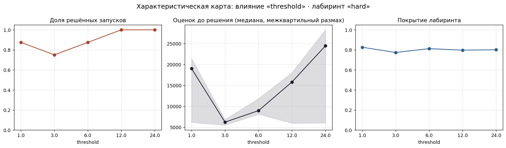

Низкий порог раздувает архив (до 11 376 записей при ρmin = 1): плотный архив делает новизну всех особей похожей, давление отбора слабеет, а поиск соседей замедляется. Исход - нестабильность (6–7 из 8). Высокий порог даёт надёжность 8 из 8, но маленький архив «забывает» исследованное, и поиск идёт медленнее (медиана 24 446 при ρmin = 24). Динамический порог сочетает оба достоинства: 8 из 8, малый архив (335) и самое короткое время. При этом он вырастает до ≈ 30, то есть сам находит масштаб расстояний задачи.

### 5.3. Размер популяции

Таблица 5.3 - Влияние размера популяции

| Размер | Решено | Оценок: медиана (мин–макс) | Оценок: среднее | Покрытие |
| --- | --- | --- | --- | --- |
| 50 | 8 из 8 | 9 268 (2 795–73 758) | 19 167 | 0,80 |
| 100 | 8 из 8 | 28 644 (2 891–55 963) | 26 248 | 0,85 |
| 250 | 8 из 8 | 9 348 (2 737–27 451) | 12 402 | 0,77 |
| 500 | 8 из 8 | 11 468 (8 635–67 625) | 24 198 | 0,86 |

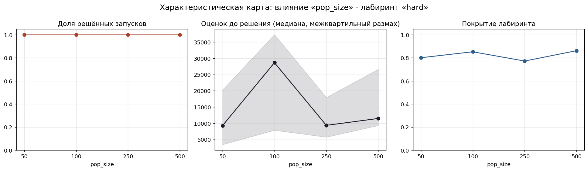

При всех размерах задача решается всегда: архив хранит разнообразие даже при маленькой популяции. Наименьшее среднее и наименьший разброс - у размера 250 (значение авторов). Разница медиан немонотонна и лежит в пределах разброса запусков, поэтому модель можно считать устойчивой к этому параметру.

### 5.4. Описание поведения

Таблица 5.4 - Точка остановки против траектории (динамический порог, начальный 20)

| Описание | Размерность | Решено | Оценок: медиана | Покрытие | Размер архива |
| --- | --- | --- | --- | --- | --- |
| Точка остановки | 2 | 8 из 8 | 35 231 | 0,83 | 104 |
| Траектория (8 точек) | 16 | 6 из 8 | 17 639 | 0,81 | 1 075 |

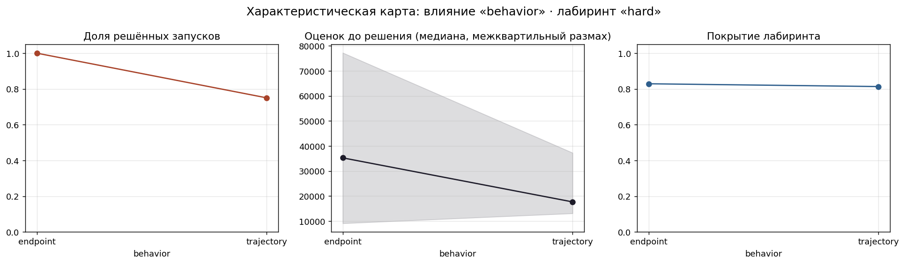

Траектория подробнее описывает поведение, но пространство поведений становится 16-мерным: алгоритм исследует много различий, не связанных с задачей (разные пути к одной точке), архив вырастает в 10 раз, надёжность падает до 6 из 8. Точка остановки надёжнее, что подтверждает выбор авторов.

Побочное наблюдение: точка остановки с начальным порогом 20 работала вчетверо медленнее, чем с начальным порогом 6 (35 231 против 9 348 оценок), и архив оказался втрое меньше. Динамическая подстройка не полностью устраняет влияние начального значения: высокий стартовый порог лишает архив ранних записей.

### 5.5. Сложность лабиринта

Таблица 5.5 - Поиск новизны на лабиринтах разной сложности

| Лабиринт | Кратчайший путь | По прямой | Обманчивость | Решено | Оценок: медиана | Покрытие | Лучшее расстояние в нерешённых |
| --- | --- | --- | --- | --- | --- | --- | --- |
| open | 194 | 198 | 0,98 | 8 из 8 | 27 | 0,26 | - |
| grid2x2 | 73 | 40 | 1,83 | 8 из 8 | 10 | 0,66 | - |
| grid3x3 | 184 | 40 | 4,61 | 8 из 8 | 69 | 0,40 | - |
| grid4x4 | 321 | 40 | 8,02 | 8 из 8 | 5 478 | 0,70 | - |
| hard (авторский) | 480 | 164 | 2,93 | 8 из 8 | 9 348 | 0,77 | - |
| grid5x5 | 525 | 40 | 13,12 | 0 из 8 | - | 0,64 | 28,0 |
| grid6x6 | 683 | 40 | 17,08 | 0 из 8 | - | 0,47 | 28,0 |

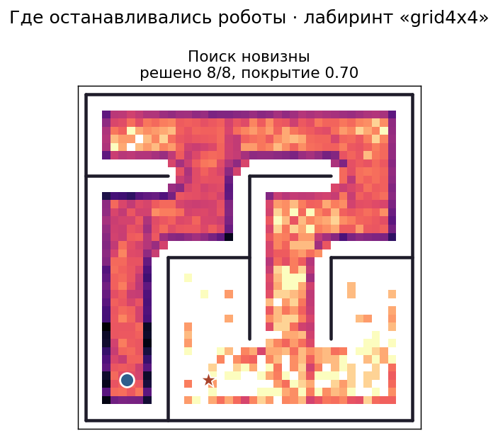
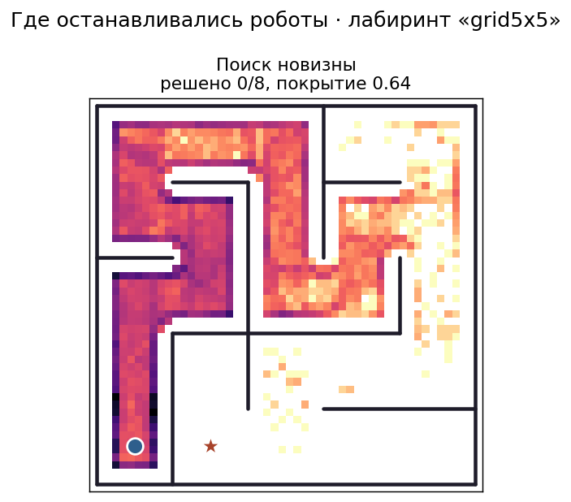

Число оценок растёт скачкообразно с длиной пути: лабиринты до 3×3 решаются почти сразу, в первом-втором поколении (не больше 337 оценок), 4×4 требует около 5,5 тыс. оценок, а 5×5 и 6×6 не решаются ни разу. Все 16 нерешённых запусков остановились в 28,0 от выхода - это точка рядом со стартом, отделённая от выхода стеной. Иначе говоря, выхода не достигал ни один робот, а покрытие (0,64 и 0,47) показывает, что лабиринт исследован не до конца.

Лабиринты grid5x5 и grid6x6 не решены по двум причинам.
1. Длина пути до выхода (525–683 ед.) с многочисленными поворотами сопоставима с пределом пробега за 400 шагов: не более 1 200 ед. даже по прямой. С учётом поворотов и разгона робот физически не успевает дойти до выхода.
2. Контроллер реактивный, без памяти, поэтому на каждой из многочисленных развилок он выбирает направление только по текущим показаниям датчиков.

Решение - увеличить число шагов симуляции (`--steps`) и лимит оценок (`--max-evals`).

Сложность лабиринта определяется длиной пути, а не обманчивостью. Лабиринт hard (обманчивость 2,93, путь 480) оказался сложнее, чем grid4x4 (обманчивость 8,02, путь 321).

## 6. Сравнение с аналогами

Поиск новизны выигрывает на обманчивых задачах, но требует удачного описания поведения и теряет преимущество, когда пространство поведений слишком велико. Численное сравнение на лабиринте hard - в разделе 4.

| Метод | Достоинства | Недостатки и ограничения | Априорная информация |
| --- | --- | --- | --- |
| Поиск новизны | Не застревает в обманчивых ловушках; широко исследует пространство поведений; часто находит простые решения | Не доводит решение до оптимума; в большом пространстве поведений исследует много бесполезного; архив растёт и замедляет поиск соседей | Описание поведения и масштаб его расстояний (от него зависит ρmin); k |
| Целевой NEAT | Прост и быстр на задачах с «честной» целевой функцией; не нужен архив | Преждевременная сходимость к локальному оптимуму на обманчивых задачах | Хорошая целевая функция, градиент которой ведёт к решению |
| Случайный отбор | Не сходится к ловушке | Не накапливает прогресс, удачные особи теряются | Не нужна (контрольный метод) |
| MAP-Elites | Сочетает разнообразие (сетка) и качество (лучшая особь в клетке); даёт набор разных хороших решений | Нужна сетка фиксированного размера; нет скрещивания и специации NEAT | Описание поведения, границы и разрешение сетки, целевая функция |
| MCNS (новизна + минимальный критерий) | Отсекает заведомо бесполезные поведения, сужая пространство поиска | Слишком строгий критерий возвращает обманчивость целевой функции | Порог минимального критерия |

Основное ограничение подхода - зависимость от описания поведения. В лабиринте точка остановки связана с задачей напрямую, и пространство поведений невелико. В задачах, где поведение описать труднее или оно имеет большую размерность, чистый поиск новизны может уступать комбинированным методам (MAP-Elites, новизна с локальной конкуренцией).

## 7. Области применения и пути улучшения

Поиск новизны полезен там, где целевая функция обманчива или цель трудно сформулировать:

- управление роботами и навигация (лабиринты, ходьба, манипуляция);
- исследование среды в обучении с подкреплением при редких наградах;
- генеративный дизайн и вычислительное творчество (изображения, формы, игровые уровни);
- поиск разнообразных тестовых сценариев и уязвимостей в сложных системах.

Возможные улучшения:

1. **Новизна с локальной конкуренцией (NSLC, Lehman, Stanley, 2011)** - двухкритериальный отбор по новизне и по качеству среди ближайших соседей.
2. **Ограничение размера архива** и быстрый поиск соседей (k-d дерево) для долгих запусков.
3. **Автоматическое описание поведения** - например, признаки автокодировщика вместо заданных вручную координат.
4. **Рекуррентные сети** - память робота о пройденном пути (сейчас используется сеть прямого распространения).

Модификации, приближающие модель к биологическому прототипу:

- **минимальный критерий (MCNS)** - реализован в работе: как в природе, для размножения достаточно «выжить», а не быть лучшим;
- **совместная эволюция тела и мозга** - датчики и морфология робота тоже мутируют;
- **открытая эволюция среды** (POET, Wang et al., 2019) - лабиринты усложняются вместе с роботами;
- **внутренняя мотивация (любопытство)** - награда за новизну на уровне отдельного агента, а не популяции.

## 8. Выводы

1. Разработана программная модель поиска новизны с NEAT для задачи навигации в лабиринте. Она позволяет менять параметры из командной строки, собирает статистику серий запусков и строит тепловые и характеристические карты.
2. На авторском сложном лабиринте подтверждён основной результат Лемана и Стэнли: поиск новизны решил 8 из 8 запусков (медиана 9 348 оценок), целевой NEAT и случайный отбор - 0 из 8. Все запуски целевого NEAT застряли в одной ловушке (38,9 от выхода), а покрытие лабиринта у поиска новизны в 1,6 раза выше.
3. Из аналогов ближе всего MAP-Elites: 8 из 8, но в 2,4 раза больше оценок. Модификация MCNS с критерием «приблизиться к выходу» надёжность снизила (6 из 8): минимальный критерий, связанный с целью, возвращает обманчивость.
4. Характеристические карты: при k = 1 надёжность падает до 2 из 8, при k ≥ 7 - 8 из 8, лучшее значение k = 15. Постоянный порог архива даёт выбор между надёжностью (высокий ρmin) и скоростью (низкий ρmin раздувает архив до 11 тыс. записей); динамический порог сочетает оба достоинства. Модель устойчива к размеру популяции (50–500). Двумерное описание поведения (точка остановки) надёжнее 16-мерного (траектория): 8 из 8 против 6 из 8.
5. Главное ограничение - сложность лабиринта. На сетках 5×5 и 6×6 (путь 525–683) поиск новизны не нашёл выход ни разу за 100 000 оценок: пространство поведений слишком велико для слепого исследования с реактивным контроллером. Для таких задач нужны больший бюджет, рекуррентные сети или комбинация новизны с качеством (раздел 7).
6. Решения, найденные поиском новизны, просты (3–4 узла, около 10 связей): трудность обманчивой задачи - не в построении сложного контроллера, а в том, чтобы найти путь к нему в обход целевой функции.

## 9. Список литературы

1. Lehman J., Stanley K. O. Abandoning Objectives: Evolution through the Search for Novelty Alone // Evolutionary Computation. 2011. Vol. 19, No. 2.
2. Lehman J., Stanley K. O. Exploiting Open-Endedness to Solve Problems Through the Search for Novelty // Artificial Life XI. 2008.
3. Lehman J., Stanley K. O. Revising the Evolutionary Computation Abstraction: Minimal Criteria Novelty Search // GECCO. 2010.
4. Lehman J., Stanley K. O. Evolving a Diversity of Virtual Creatures through Novelty Search and Local Competition // GECCO. 2011.
5. Stanley K. O., Miikkulainen R. Evolving Neural Networks through Augmenting Topologies // Evolutionary Computation. 2002. Vol. 10, No. 2.
6. Stanley K. O., Lehman J. Why Greatness Cannot Be Planned: The Myth of the Objective. Springer, 2015.
7. Mouret J.-B., Clune J. Illuminating Search Spaces by Mapping Elites. arXiv:1504.04909, 2015.
8. Holland J. Adaptation in Natural and Artificial Systems. University of Michigan Press, 1975.
9. Omelianenko I. Hands-On Neuroevolution with Python. Packt, 2019.
10. Wang R., Lehman J., Clune J., Stanley K. O. Paired Open-Ended Trailblazer (POET). arXiv:1901.01753, 2019.
11. neat-python: документация и исходный код - https://github.com/CodeReclaimers/neat-python

## 10. Тексты программ
https://github.com/Mouser5/Novelty_search/tree/master
